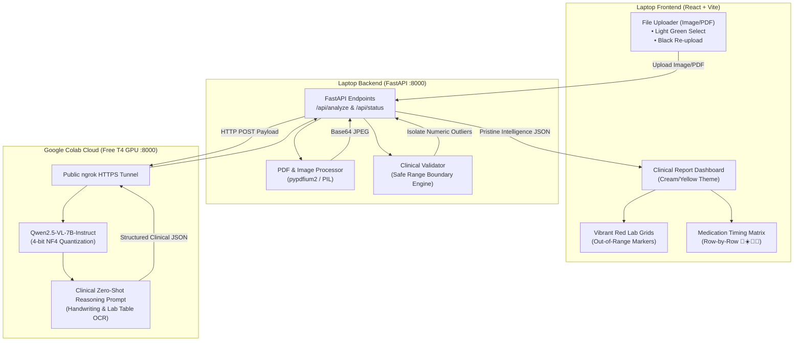

# Project 2: Specialized Zero-Shot Medical Chart & Prescription Intelligence:

A secure clinical web dashboard where users upload high-resolution smartphone photographs of messy, handwritten doctor prescriptions or complex multi-page laboratory diagnostic reports.

---

## 🏛️ System Architecture



---

## 📂 Complete Project File Structure in VS Code

```text
Specialized Zero-Shot Medical Chart & Prescription Intelligence/
├── .gitignore                         <-- Git ignore (Root level)
├── README.md                          <-- Comprehensive Documentation & Guide
│
├── backend/                           <-- FastAPI Laptop Backend
│   ├── .venv/                         <-- Python Virtual Environment (Created inside backend)
│   ├── .env                           <-- Active Environment Variables (COLAB_API_URL, PORT)
│   ├── .env.example                   <-- Template Environment File
│   ├── requirements.txt               <-- Python Dependencies List
│   ├── main.py                        <-- FastAPI App Entrypoint (CORS & Server Setup)
│   └── app/
│       ├── __init__.py
│       ├── config.py                  <-- Pydantic BaseSettings loader
│       ├── schemas.py                 <-- Pydantic Data Models (Lab, Medication, Patient)
│       ├── services/
│       │   ├── __init__.py
│       │   ├── pdf_processor.py       <-- PDF/Image rasterizer (pypdfium2/Pillow)
│       │   ├── clinical_validator.py  <-- Boundary check & red anomaly isolation engine
│       │   └── colab_client.py        <-- Client communicating with Colab ngrok tunnel
│       └── routes/
│           ├── __init__.py
│           └── analysis.py            <-- /api/analyze, /api/status, /api/sample
│
├── frontend/                          <-- React + Vite Dashboard
│   ├── node_modules/                  <-- NPM Packages (Created on npm install)
│   ├── package.json                   <-- NPM Scripts & Frontend Dependencies
│   ├── vite.config.js                 <-- Vite dev server & API proxy config
│   ├── tailwind.config.js             <-- Custom Palette: Cream, Med-Yellow, Clinical-Green
│   ├── postcss.config.js              <-- PostCSS Tailwind plugins
│   ├── index.html                     <-- HTML5 Entrypoint with Medical Typography
│   └── src/
│       ├── main.jsx                   <-- React DOM Root
│       ├── App.jsx                    <-- Master Dashboard Component
│       ├── index.css                  <-- Global Tailwind styles & print CSS
│       ├── services/
│       │   └── api.js                 <-- API fetch utilities
│       └── components/
│           ├── Header.jsx             <-- Medical Header & Colab Status indicator
│           ├── FileUploader.jsx       <-- Upload Zone with Green Select & Black Reset
│           ├── PatientOverview.jsx    <-- Patient & Doctor Classification Card
│           ├── LabMetricsGrid.jsx     <-- Vibrant Red Grid for Out-of-Range markers
│           ├── MedicationTimingMatrix.jsx <-- Row-by-Row Drug Schedule (🌅☀️🌆🌙)
│           ├── ClinicalAlerts.jsx     <-- High-risk anomaly warnings banner
│           ├── DocumentViewerModal.jsx<-- Fullscreen original document viewer
│           └── LoadingOverlay.jsx     <-- Qwen2.5-VL Vision reasoning animation
│
└── colab/                             <-- Google Colab Cloud Workload
    ├── medical_qwen_vl_colab.ipynb    <-- Ready-to-run Jupyter Notebook for Colab T4
    └── colab_server.py                <-- Self-contained Colab Python script
```

---

## ⚡ Quick Summary of File Placements

| Component | File Path | Purpose |
| :--- | :--- | :--- |
| **Virtual Environment** | `backend/.venv/` | Python isolated sandbox created inside the `backend` folder |
| **Env Variables** | `backend/.env` | Holds `COLAB_API_URL`, `PORT=8000`, `FALLBACK_TO_MOCK_IF_OFFLINE` |
| **Git Ignore** | `.gitignore` | Located in root directory; ignores `.venv/`, `node_modules/`, `.env` |
| **Requirements** | `backend/requirements.txt` | Lists backend dependencies (`fastapi`, `uvicorn`, `pypdfium2`, etc.) |
| **Frontend Config** | `frontend/package.json` | Lists React, Vite, Tailwind CSS, Lucide icons |
| **Colab Script** | `colab/medical_qwen_vl_colab.ipynb` | Run on Google Colab with free T4 GPU |

---

## 🚀 Running the Project (Step-by-Step)

### Terminal 1: FastAPI Backend (Runs on http://127.0.0.1:8000)

```powershell
cd "d:\Specialized Zero-Shot Medical Chart & Prescription Intelligence\backend"
.\.venv\Scripts\Activate.ps1
python main.py
```
> The API server starts on **`http://127.0.0.1:8000`**.  
> Interactive OpenAPI documentation is accessible at **`http://127.0.0.1:8000/docs`**.

### Terminal 2: React + Vite Frontend (Runs on http://localhost:5173)

```powershell
cd "d:\Specialized Zero-Shot Medical Chart & Prescription Intelligence\frontend"
npm run dev
```
> Open **`http://localhost:5173`** in your browser. All requests to `/api` automatically proxy to **`http://127.0.0.1:8000`**.

---

### Google Colab (Qwen2.5-VL-7B on T4 GPU)

1. Upload [`colab/medical_qwen_vl_colab.ipynb`](file:///d:/Specialized%20Zero-Shot%20Medical%20Chart%20&%20Prescription%20Intelligence/colab/medical_qwen_vl_colab.ipynb) to Google Colab.
2. Select **Runtime > Change runtime type > T4 GPU**.
3. Run Step 1 and Step 2:
   ```python
   !pip install -q -U --force-reinstall "pillow>=10.4.0,<11.2.0"
   !pip install -q -U "bitsandbytes>=0.46.1" "transformers>=4.49.0" accelerate torchvision
   !pip install -q -U qwen-vl-utils fastapi uvicorn pyngrok nest_asyncio pydantic python-multipart
   ```
4. Click **Runtime > Restart session** (clears cached libraries & links CUDA).
5. Run Step 3, 4, and 5 to start the public server tunnel.


